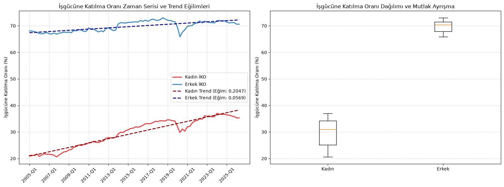
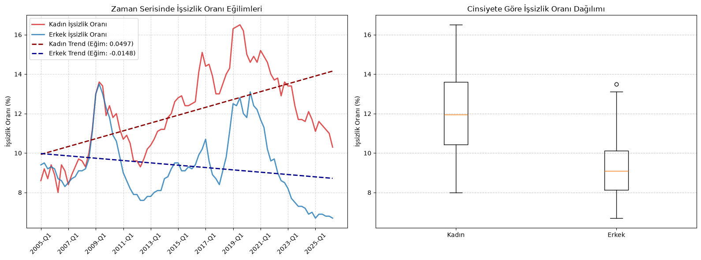

# Temel İşgücü Göstergeleri İstatistiksel Analizi

https://veriportali.tuik.gov.tr/tr/databrowser/tuik/categories/8/8_2/8_2_2/TR,DF_ISGUCU_CEYREK_TEMEL_ISGUCU_C,1.0

Bu proje, TÜİK (Türkiye İstatistik Kurumu) verileri kullanılarak Türkiye işgücü piyasasındaki cinsiyet temelli asimetrilerin istatistiksel ve makroekonomik boyutlarını incelemektedir. Analiz, salt ortalama karşılaştırmalarının ötesine geçerek yapısal eşitsizlikleri matematiksel modellerle kanıtlamayı amaçlamaktadır.

## İstatistiksel Metodoloji

Proje kapsamında aşağıdaki bilimsel testler ve analizler uygulanmıştır:
*   **Normallik Varsayımı (Shapiro-Wilk Testi):** Veri setlerinin dağılım karakteristikleri test edilmiş ve parametrik olmayan testlerin zorunluluğu kanıtlanmıştır.
*   **Bağımsız Gruplar Analizi (Mann-Whitney U Testi):** İşgücüne Katılma Oranı (İKO) ve İşsizlik Oranı verilerindeki cinsiyet temelli uçurumun istatistiksel anlamlılığı (p < 0.05) ve mutlak ayrışması (U=0.00) test edilmiştir.
*   **Zaman Serisi Regresyonu (1. Derece Polinom Uyumu / OLS):** 86 çeyreklik periyottaki (yaklaşık 21.5 yıl) trend eğimleri hesaplanmış, gruplar arası yakınsama (convergence) ve ıraksama (divergence) durumları matematiksel olarak modellenmiştir.

## Temel Bulgular ve Görsel Analizler

### 1. Piyasaya Giriş Bariyeri (İşgücüne Katılma Oranı)
Kadınların işgücüne katılımı (%29.59) ile erkeklerin katılımı (%69.80) arasında istatistiksel olarak mutlak bir ayrışma saptanmıştır (Mann-Whitney U = 0.00). Zaman serisi trend eğimleri, aradaki devasa makasın istatistiksel olarak kapanma eğiliminde olmasına rağmen mevcut uçurumun yapısal olarak korunduğunu göstermektedir.

### 2. İstihdam Edilebilirlik Bariyeri (İşsizlik Oranı)
Piyasaya dahil olan azınlık kadın grubunun, iş arama sürecinde de sistematik olarak daha yüksek işsizlik oranlarıyla (%12.04) karşılaştığı doğrulanmıştır. Makroekonomik trend incelendiğinde; kadın işsizliği artış ivmesindeyken (Trend eğimi: 0.0497), erkek işsizliğinin yatay/düşüş ivmesinde (Trend eğimi: -0.0148) olması makasın giderek daha da açıldığını (divergence) kanıtlamaktadır.

### 3. Makroekonomik Uyumsuzluk (Bütünleşik Sentez)
Zaman serisi analizleri, kadın işgücüne katılımı artarken eş zamanlı olarak kadın işsizliğinin de yükseliş trendinde olduğunu göstermektedir. Bu durum, piyasanın net istihdam yaratma kapasitesinin cinsiyete karşı asimetrik çalıştığını ve yeni kadın işgücünü istihdama dönüştüremediğini ispatlar.

## Teknik Altyapı
*   **Dil:** Python
*   **Kütüphaneler:** Pandas (Veri manipülasyonu), SciPy & NumPy (İstatistiksel modelleme ve regresyon), Matplotlib (Veri görselleştirme)
*   **Ortam:** Jupyter Notebook